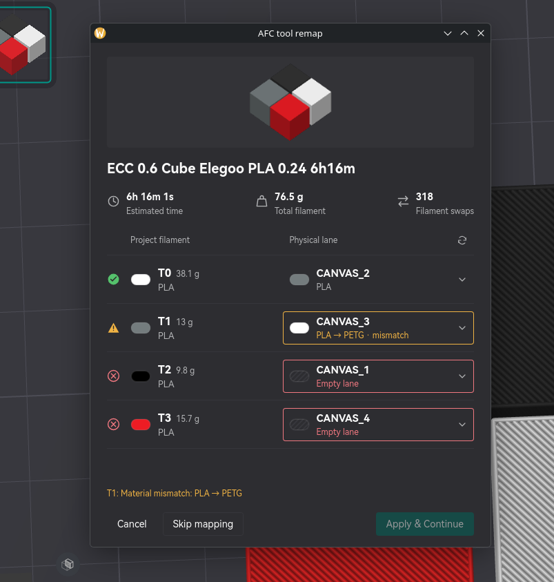

# AFC tool remap

Choose which physical AFC lane supplies each filament before OrcaSlicer uploads a print through Moonraker.

The mapping window shows the print preview, estimated time, filament usage and swap count. Each used tool is listed with its material and color alongside a dropdown for choosing its physical lane. Lane choices show material, color and remaining grams when available.

- **Refresh** reloads the current AFC state while preserving your lane selections where possible.
- **Material mismatches** appear as warnings and allow you to continue. Empty lanes and duplicate lane assignments block Apply.
- **Apply & Continue** updates the printer's tool mapping, verifies it, then lets OrcaSlicer continue the upload or Upload & Print action you selected.
- **Skip mapping** continues with the printer's current mapping without changing it.
- **Cancel** stops the send.

The plugin requests host-wide network access using the configured printer’s canonical URL (for example, `http://192.0.2.1`, without a path or port) before loading AFC state. Orca saves this grant for subsequent requests. If this first attempt is blocked while the permission prompt is open, approve access and click **Refresh** to load the state.

Mapping changes persist on the printer. The plugin supports one-to-one tool-to-lane assignments and leaves G-code unchanged. Disk exports and sends through other printer hosts are unaffected.

When used with **Compact G-code Tools**, run compaction first so the mapping window shows the final outgoing tool numbers.
